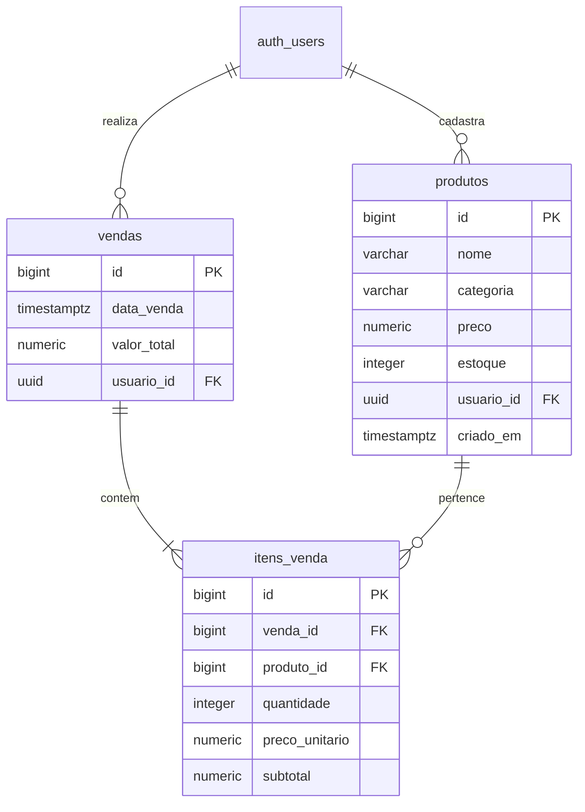

# 🥖 PadariaTech — Sistema de Gestão de Padaria

> Projeto prático desenvolvido com **Google Antigravity**, **Supabase MCP**, **Vercel MCP** e **Git**, concebido para os estudantes do curso Técnico em Desenvolvimento de Sistemas.

---

## 📌 1. Visão Geral do Projeto

O **PadariaTech** é uma aplicação web full stack completa, moderna e responsiva voltada para a rotina diária de pequenas e médias padarias. O sistema resolve as principais dores operacionais do negócio:

- Controle de catálogo de produtos com categorização e preços.
- Monitoramento de estoque em tempo real com alerta de produtos em nível crítico (≤ 10 unidades).
- Ponto de Venda (PDV / Balcão) ágil com carrinho interativo e baixa automática de estoque.
- Histórico completo de vendas realizadas com detalhamento item a item.
- Dashboard executivo com indicadores-chave de desempenho (total de produtos, estoque baixo, quantidade de vendas e faturamento total).

---

## 🎓 2. Objetivo Educacional

Demonstrar aos estudantes de Desenvolvimento de Sistemas na prática:
1. Como construir arquiteturas web robustas sem depender de frameworks pesados, dominando **HTML5, CSS3 moderno e JavaScript ES6+ modular**.
2. Como projetar um banco de dados relacional seguro no **PostgreSQL** hospedado na nuvem (**Supabase**).
3. O princípio de **Row Level Security (RLS)**: garantindo que cada usuário acesse exclusivamente seus próprios dados diretamente a nível de banco de dados.
4. O uso de **Stored Procedures / RPC (Remote Procedure Calls)** em PL/pgSQL com `SECURITY DEFINER` para processar transações financeiras e de estoque de forma atômica (ACID), evitando manipulação de preços pelo navegador e condições de corrida (*race conditions*).
5. O fluxo de **DevOps moderno** utilizando **Model Context Protocol (MCP)** para automação de infraestrutura no Supabase e na Vercel.

---

## 🛠️ 3. Tecnologias Utilizadas

| Camada | Tecnologia | Função no Projeto |
|---|---|---|
| **Frontend** | HTML5 Semântico | Estruturação acessível das telas |
| **Estilização** | CSS3 Moderno (Custom Properties, Flexbox, Grid) | Identidade visual artesanal (creme, caramelo e marrom nobre), responsiva para mobile e desktop |
| **Lógica** | JavaScript ES6+ (Módulos Nativos) | Regras de interface, estado do carrinho e orquestração de APIs |
| **Bundler & Dev Server** | Vite 6 | Servidor ultrarrápido com Hot Module Replacement (HMR) e empacotamento otimizado para produção |
| **Backend & Dados** | Supabase (PostgreSQL 17) | Banco de dados relacional, autenticação gerenciada e RPC |
| **Autenticação** | Supabase Auth | Gerenciamento de credenciais com JWT seguro e persistência de sessão |
| **Hospedagem** | Vercel | Plataforma de nuvem com distribuição global (Edge CDN) e deploy contínuo |
| **Automação** | Supabase MCP & Vercel MCP | Protocolo de ferramentas do agente inteligente para inspecionar, migrar e gerenciar infraestrutura |

---

## 🏛️ 4. Arquitetura e Organização de Pastas

```
padariatech/
├── index.html                   # Ponto de entrada SPA (Single Page Application)
├── package.json                 # Manifesto de dependências e scripts npm
├── vite.config.js               # Configuração do bundler Vite
├── .env.example                 # Modelo didático de variáveis de ambiente
├── .gitignore                   # Proteção contra upload de credenciais e dependências
├── README.md                    # Documentação técnica e operacional completa
├── src/
│   ├── css/
│   │   └── style.css            # Folha de estilos unificada com variáveis CSS
│   └── js/
│       ├── supabaseClient.js    # Instância única do cliente Supabase SDK
│       ├── auth.js              # Serviços de cadastro, login, logout e sessão
│       ├── produtos.js          # CRUD de produtos e gerador de dados de exemplo
│       ├── vendas.js            # Integração com RPC transacional de venda e histórico
│       ├── dashboard.js         # Consolidação e cálculo de métricas em tempo real
│       └── app.js               # Controlador mestre, rotas e eventos da interface
└── supabase/
    └── migrations/
        └── 20261105_001_padariatech.sql # Migração SQL idempotente e segura
```

---

## 🗄️ 5. Modelo de Dados (PostgreSQL)



### Regras de Integridade Relacional:
- `produtos.preco`: Restrição `CHECK (preco > 0)`.
- `produtos.estoque`: Restrição `CHECK (estoque >= 0)`.
- `itens_venda.produto_id`: Restrição `ON DELETE RESTRICT` — impede a exclusão acidental de produtos que possuam histórico de vendas registradas.
- `itens_venda.preco_unitario` e `itens_venda.subtotal`: Mantém o registro histórico imutável do valor praticado no momento da venda, mesmo que o cadastro do produto seja reajustado posteriormente.

---

## 🛡️ 6. Segurança e Autenticação

1. **Supabase Auth**: Senhas são tratadas com hash seguro (Argon2/bcrypt) diretamente pelo Supabase Auth. Nenhuma senha trafega em texto puro ou é salva em tabelas públicas.
2. **Row Level Security (RLS)**: Habilitado em todas as tabelas (`produtos`, `vendas`, `itens_venda`). A política base garante que cada usuário só consegue visualizar, editar ou deletar registros com `auth.uid() = usuario_id`.
3. **Privilégios Mínimos e Anti-Fraude**:
   - As tabelas `vendas` e `itens_venda` possuem permissões de `INSERT/UPDATE/DELETE` revogadas para os papéis `authenticated` e `anon`.
   - Nenhuma venda pode ser forjada inserindo registros diretamente no frontend com preços inventados.
4. **Função RPC Transacional (`registrar_venda`)**:
   - Executada com `SECURITY DEFINER` e `SET search_path = public, pg_temp`.
   - Valida a identidade de quem chamou via `auth.uid()`.
   - Bloqueia as linhas do produto com `SELECT ... FOR UPDATE` para impedir concorrência predatória (duas abas vendendo o mesmo último item simultaneamente).
   - Consulta o preço oficial cadastrado no banco, calcula subtotais e valor total no servidor.
   - Deduz o estoque automaticamente.
   - Reverte toda a operação (Rollback ACID) se o estoque for insuficiente em qualquer dos itens.

---

## 🚀 7. Como Executar o Projeto Localmente

### Pré-requisitos
- **Node.js** v18 ou superior instalado.
- Gerenciador de pacotes **npm**.

### Passo a Passo

1. **Clonar o Repositório ou acessar a pasta:**
   ```bash
   cd padariatech
   ```

2. **Instalar as Dependências:**
   ```bash
   npm install
   ```

3. **Configurar as Variáveis de Ambiente:**
   Copie o arquivo de exemplo:
   ```bash
   cp .env.example .env
   ```
   Edite o arquivo `.env` com a URL e a Publishable Key do seu projeto Supabase:
   ```env
   VITE_SUPABASE_URL=https://seu-projeto.supabase.co
   VITE_SUPABASE_PUBLISHABLE_KEY=sua_chave_publicavel_aqui
   ```

4. **Executar a Migração no Supabase:**
   Abra o painel do Supabase > **SQL Editor** e execute o conteúdo do arquivo:
   `supabase/migrations/20261105_001_padariatech.sql`

5. **Iniciar o Servidor de Desenvolvimento:**
   ```bash
   npm run dev
   ```
   O terminal exibirá a URL local (geralmente `http://localhost:3000`).

6. **Gerar Build de Produção para Validação:**
   ```bash
   npm run build
   ```

---

## 🌐 8. Publicação na Vercel

A publicação é realizada conectando o repositório ou enviando o build de produção com as seguintes diretrizes:
- **Framework Preset**: Vite
- **Build Command**: `npm run build`
- **Output Directory**: `dist`
- **Variáveis de Ambiente configuradas na Vercel**:
  - `VITE_SUPABASE_URL`
  - `VITE_SUPABASE_PUBLISHABLE_KEY`

---

## 🤖 9. Automação com MCP (Model Context Protocol)

O projeto utilizou o poder do MCP integrado ao ambiente **Google Antigravity**:
- **Supabase MCP**: Conexão com o banco de dados remoto, listagem de esquemas, validação de permissões e execução controlada de migrações SQL sem necessidade de abrir abas externas no navegador.
- **Vercel MCP**: Gestão remota de projetos, configuração de variáveis de ambiente e acompanhamento de deployments em tempo real.
- **Git**: Controle de versão estrito, garantindo commits semânticos e integridade do repositório.

---

## 📄 10. Licença e Créditos

Desenvolvido para fins estritamente pedagógicos e educacionais no curso Técnico em Desenvolvimento de Sistemas.
Distribuído sob licença MIT.
